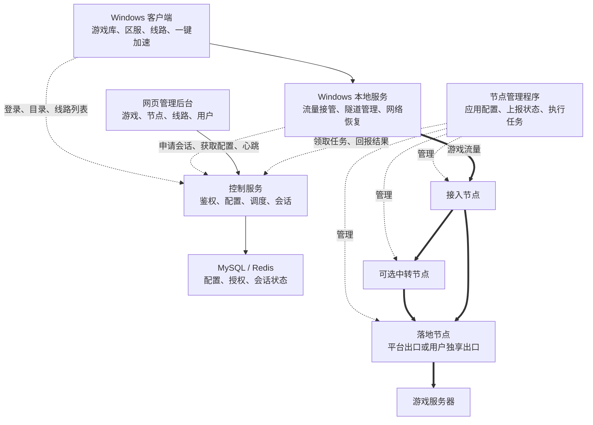
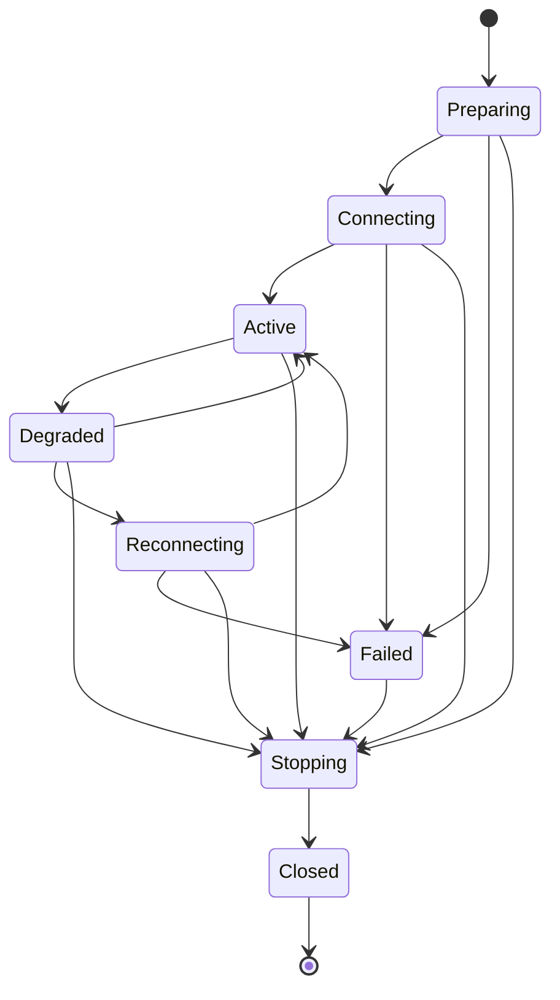

# 游戏加速器完整架构方案

更新日期：2026-10-13

状态：待实施的架构设计。本文不表示当前 APIRouter 已具备以下功能。

## 目录

- [产品目标与首版范围](#scope)
- [整体架构与技术选型](#architecture)
- [Windows 客户端](#windows-client)
- [流量接管与游戏规则](#game-rules)
- [节点、端点与独立线路](#lines)
- [线路发布与配置生效](#publishing)
- [共享、独享和自带落地](#egress)
- [加速会话生命周期](#sessions)
- [线路推荐与质量探测](#scheduling)
- [节点管理与数据通道授权](#node-agent)
- [网页管理后台](#admin)
- [数据模型](#data-model)
- [API 设计](#api)
- [运行保障、监控和计费](#operations)
- [部署与工程组织](#deployment)
- [实施阶段与验收](#delivery)
- [参考资料](#references)

<a id="scope"></a>

## 产品目标与首版范围

建设一套独立的游戏加速平台，包括 Windows 客户端、网页管理后台、控制服务和转发网络。

已确定的产品要求：

1. Windows 客户端参考 UU 类产品的使用体验：游戏库、区服选择、线路选择、一键加速和运行状态。界面与交互自行设计，不假定掌握 UU 或雷神的内部实现。
2. 线路作为独立资源配置，支持多个地区和多条路径。沪韩只是可配置的线路之一；客户端不写死地区、服务器地址或路径。
3. 游戏与线路是多对多关系。游戏规则描述需要接管的流量，线路描述流量经过的网络路径。
4. 后台能够管理已有线路，并逐步接管节点部署、配置发布、健康检查和回滚。
5. 支持平台共享出口、平台独享出口，以及用户自带落地。
6. 游戏流量与业务 API 分离；配置、授权和监控不进入逐包转发路径。

建议首版以 Windows x64 为测试目标，每台设备同时运行一个加速会话。支持少量经过实测的游戏和多条独立配置的线路；其他地区可以通过后台扩展。移动端、游戏主机、多个游戏同时加速、无感切线和冗余传输作为后续扩展。

该产品建议使用独立工程和独立部署，可沿用 APIRouter 团队熟悉的 Spring Boot、React、MySQL 和 Redis 技术。本仓库先保存设计文档，具体项目名称和部署资源在实施时确定。

<a id="architecture"></a>

## 整体架构与技术选型



图中的加粗连线承担游戏数据传输。游戏数据不经过网页后台、业务 API 或数据库。直连落地时，接入和落地可以是同一个节点。

| 组件 | 推荐实现 | 职责 |
| --- | --- | --- |
| Windows 界面 | C# / WPF | 游戏、区服、线路、账户与状态展示 |
| Windows 本地服务 | .NET Windows Service | 网络内核生命周期、配置、探测、恢复 |
| 客户端网络内核 | 首版验证成熟 TUN 内核，使用适配层封装 | TCP/UDP 接管、分流和隧道 |
| 网页后台 | React + TypeScript | 资源配置、发布和运维 |
| 控制服务 | Spring Boot 模块化单体 | 鉴权、目录、配置、调度、会话和授权 |
| Node Agent | Go | 管理 Linux 节点配置、进程、授权和指标 |
| 节点转发服务 | 按线路选择 Realm、SS2022 服务端等实现 | 执行转发或终止隧道 |
| 存储与监控 | MySQL、Redis、Prometheus、Grafana | 配置持久化、租约缓存、指标和告警 |

控制服务先采用模块化单体，以业务边界组织代码。后续依据实际负载拆分。技术选型中的 WPF、TUN 内核、节点协议与服务端实现，都需在网络验证阶段固定具体版本。

<a id="windows-client"></a>

## Windows 客户端

### 用户界面

| 页面 | 功能 |
| --- | --- |
| 游戏首页 | 搜索、游戏卡片、最近加速、我的游戏 |
| 游戏详情 | 区服、推荐线路、手动选线、开始加速 |
| 加速面板 | 当前线路、连接状态、延迟、丢包、出口、停止加速 |
| 线路列表 | 地区、适用运营商、质量、可用性、共享或独享标识 |
| 自定义游戏 | 选择游戏 EXE、关联进程和本地安装路径 |
| 设置与诊断 | 网络检测、日志导出、更新、网络修复 |
| 账户中心 | 设备、授权、可用线路和自带落地 |

正常流程：选择游戏 → 选择区服 → 自动推荐或手动选线 → 开始加速。

普通玩家不编辑服务器配置。管理员维护游戏目录、规则和线路，客户端按授权获取。自带落地作为高级功能展示。

### 界面与本地服务分离

界面进程负责交互，本地服务执行需要权限的网络操作。两者通过有访问权限控制的本机通信接口交互，可采用命名管道。接口使用结构化操作，不提供任意命令执行能力。

关闭窗口到托盘不等于停止加速。明确的“退出并停止加速”操作完成清理后退出。界面崩溃不应直接结束隧道；重新打开界面能够恢复实际运行状态。

网络内核适配层提供统一能力：检查能力、校验配置、启动、查询状态、读取统计、停止和恢复网络。界面与业务逻辑不直接依赖某个内核的原生配置格式。

<a id="game-rules"></a>

## 流量接管与游戏规则

### 首版路径与后续扩展

首版优先验证成熟网络内核的 TUN 与进程分流能力，例如 Mihomo。后续需要更精细的应用控制时，再增加 WFP 实现。[Mihomo 规则文档](https://wiki.metacubex.one/config/rules/)列出了进程路径、进程名称、域名、IP 和协议规则。

Wintun 提供虚拟网卡和数据包读写，进程识别、分流和隧道仍需由其他模块实现。WFP 的 ALE 层支持按应用身份过滤，也提供连接重定向能力。以上能力分别见[微软 ALE 文档](https://learn.microsoft.com/en-us/windows/win32/fwp/application-layer-enforcement--ale-)、[连接重定向文档](https://learn.microsoft.com/en-us/windows-hardware/drivers/network/using-bind-or-connect-redirection)和 [Wintun 文档](https://www.wintun.net/)。

### 游戏规则结构

| 字段组 | 内容 |
| --- | --- |
| 基础资料 | 游戏 ID、名称、封面、状态 |
| 区服 | 可用地区、区服标识、默认策略 |
| 主进程 | EXE 名称、路径匹配规则 |
| 关联进程 | 登录器、语音、必要辅助进程 |
| 目标规则 | 域名、IP/CIDR、端口、TCP/UDP |
| 排除规则 | 不需要加速的更新下载或其他连接 |
| DNS | 与区服匹配的解析策略及例外 |
| 版本 | 规则版本、最低客户端能力、发布状态 |

后台保存应用识别规则，不保存固定 PID。客户端根据本次运行的应用，关联当前网络连接。路径匹配优先于过宽的进程名匹配，共享进程场景结合目标规则处理。

规则可以同时表达主进程及经过确认的关联进程，不默认把所有子进程都纳入加速。游戏更新后，规则独立发布，通常无需重新安装客户端。

### 分流与恢复约束

- 排除隧道自身和节点控制连接，防止流量循环进入隧道。
- 普通模式下，未命中游戏规则的流量按直连策略处理；目标游戏无法识别时展示诊断状态，不宣称已验证加速。
- DNS 可能由系统服务发起，不能仅按游戏进程规则处理。需要维护解析结果、域名规则与连接目的地址的对应关系，并测试共享域名和缓存变化。
- 域名解析策略与线路区服协调；避免仅改变游戏数据路径却保留不合适的解析结果。
- 启动、停止、休眠恢复和切换网卡均通过本地服务统一处理。
- 只撤销本程序创建且仍由本程序拥有的网络配置，避免覆盖用户或其他软件后续修改的 DNS 和路由。
- 固定出口模式可提供“出口保护”：隧道失效时暂停指定游戏连接，等待恢复或用户明确停止。该模式需验证故障后的真实阻断行为，不能只在界面显示已保护。

首版优先验证 SS2022 的 TCP/UDP 路径，并以实际游戏结果决定支持列表。协议适配层预留 WireGuard 等后续实现，不将未验证的协议直接标记为可用。

<a id="lines"></a>

## 节点、端点与独立线路

### 资源边界

| 资源 | 含义 |
| --- | --- |
| 节点 Node | 一台受管理服务器，或一个登记的外部服务资源 |
| 端点 Endpoint | 节点上的具体服务地址、端口、协议、凭据引用和能力 |
| 线路 Line | 面向用户的逻辑路径及授权、展示、容量策略 |
| 线路版本 Line Version | 一次发布后不再修改的路径配置 |
| 路径步骤 Hop | 该版本中的有序入口、中转、落地步骤及连接方式 |

一个节点可运行多个端点，也可兼任接入、中转和落地。游戏与线路通过区服、协议能力、用户权限和可选的游戏例外策略关联。

### 线路配置

每条线路至少包含：

- ID、名称、展示分组。
- 运行模式：导入现成线路或平台托管。
- 入口端点、有序中转步骤、落地端点或落地选择策略。
- 适用地区、适用运营商和可选游戏限制。
- TCP/UDP、入口 IPv4/IPv6、出口目的地址族和客户端能力要求。
- 协议、凭据引用、最低客户端版本。
- 优先级、容量限制、用户或套餐授权范围。
- 发布状态、维护状态和配置版本。

支持的拓扑包括：

```text
客户端 → 落地
客户端 → 入口 → 落地
客户端 → 入口 → 中转 → 落地
客户端 → 平台入口 → 用户自己的落地
```

后台新增沪韩、沪日或其他地区线路，客户端刷新可用配置即可展示。新增协议仍要求客户端已经支持该协议，不能仅通过下发配置实现任意新协议。

### 路径校验

编译线路配置时需要验证每一段的协议和可达性，不能把任意节点、任意协议直接拼接。透明端口转发和终止隧道是不同能力，必须在节点适配器中区分。

入口地址族与游戏目标地址族分别描述。例如 IPv6 入口配 IPv4 落地，并不意味着线路能够访问 IPv6 游戏服务器。用户没有可用 IPv6 时，IPv6-only 入口应标记不可用或从候选中排除。

线路能力取整条路径的实际能力，不能只使用入口节点声明。任一段不支持 UDP，则不能作为需要 UDP 的游戏线路发布。

<a id="publishing"></a>

## 线路发布与配置生效

| 模式 | 行为与边界 |
| --- | --- |
| 导入现成线路 | 录入已部署服务，检测可用性并分配用户；不代表已经获得远程部署、撤销用户或统计能力 |
| 平台托管线路 | Agent 应用配置、维护转发服务、执行授权、检测与回滚 |

现有 Realm、SS2022 服务可以先作为导入线路接入，再逐步纳入托管。

托管线路发布流程：

```text
草稿 → 校验 → 生成配置版本 → 节点准备并应用
     → 回报实际版本 → 路径健康检查 → 发布为可选线路
```

控制服务记录每个节点的期望版本和实际版本。只有所需节点都就绪且路径检查通过，才允许新会话使用。该流程通过任务重试和状态核对收敛，不假设多台机器具有数据库式原子提交能力。

变更失败时保留上一个可用版本并记录失败节点和原因。如果变更会影响正在使用的监听或进程，先进入维护或排空流程，不通过重启整台机器上的共享服务来隐式升级。

线路停用有两种操作：停止接收新会话、立即结束已有会话。普通维护使用前者，紧急撤销使用后者。线路地址、路径和落地修改默认只作用于新会话。

<a id="egress"></a>

## 共享、独享和自带落地

落地支持三种来源：平台共享出口、平台分配的独享出口、用户自带落地。

自带落地需要协议、地址、端口和凭据，完成认证、TCP/UDP、实际出口和路径可达性检测后才能使用。只有一个公网 IP 不足以建立代理连接。

用户绑定的是落地资源和访问权限，线路选择的是通往该落地的可用路径。一次会话固定落地绑定，不能因推荐分数轻微变化就切换出口。

当前单目标 Realm 监听不会根据后台的用户绑定自动选择不同落地。首版可为不同落地绑定分配不同入口端口；后续再接入能够按用户身份路由的网关。端口分配需检查冲突、记录所有权，并在资源释放后按策略回收。

独享与固定 IP 分别记录。家宽地址或 DDNS 解析可能改变，需要检测实际出口，向受影响会话报告变化。域名相同不意味着公网出口保持不变。重连也不保证原连接的出口端口映射不变。

<a id="sessions"></a>

## 加速会话生命周期

一次会话保存用户、设备、游戏区服、游戏规则版本、线路版本、落地绑定、授权租约和实际运行状态。

启动流程：

1. 本地服务检查网络能力、内核状态和残留配置。
2. 控制服务筛选可用线路，客户端按需探测候选。
3. 用户选线或接受推荐，申请创建会话。
4. 后端检查授权、设备并发、线路容量和落地访问权，预留资源。
5. 固定本次规则与线路版本，托管节点准备对应授权。
6. 客户端获取必要连接配置，建立隧道并检查回包。
7. 本地服务应用游戏分流，回报运行状态；确认就绪后显示加速中。
8. 会话运行期间续租并上报质量。
9. 停止时撤销本地规则、结束节点侧授权、释放容量并记录结束原因。



失败原因独立保存，失败路径也必须完成资源清理。准备阶段有超时，不能永久占用并发名额或端口。停止操作幂等，节点暂时离线时由租约和重试任务最终回收。

创建会话使用幂等键。客户端重试同一个请求时获得原会话，不能生成多个付费或占容量的连接。容量预留与会话创建需要一致性控制，不能仅依赖一次缓存计数。

第一版切线按可能重连处理。实现无感切换需要保持隧道会话和落地连接映射，不能仅凭出口 IP 相同就保证对局不中断。

<a id="scheduling"></a>

## 线路推荐与质量探测

候选筛选顺序：区服和协议能力 → 用户与落地权限 → 维护和健康状态 → 容量 → 少量候选路径探测 → 排序推荐。

| 指标 | 用途 |
| --- | --- |
| RTT 中位数与高分位 | 区分日常延迟与尖峰 |
| 抖动、丢包 | 判断实时通信稳定性 |
| UDP 建链与回包成功率 | 识别 TCP 正常但 UDP 不通的路径 |
| 带宽、包速率、连接数、CPU | 判断节点容量与拥塞 |
| 实际出口地址 | 检查落地是否符合会话选择 |
| 指标时间与样本量 | 避免使用过期或样本不足的评分 |

初期使用可配置的规则评分即可，先过滤硬性不兼容，再比较延迟、丢包、抖动和负载。权重应根据实测校准，不预设所有运营商和游戏使用相同权重。

探测需覆盖实际转发路径，不能只 ping 国内入口。完整线路探测可以使用经过该隧道访问的受控探测端点。此结果仍不等同于游戏服务器的实际 RTT。

界面分别标明入口延迟、线路探测延迟和可测的游戏延迟。游戏服务器不响应探测时显示无法测量，不将其直接判为线路故障，也不以入口延迟替代。

活跃对局固定线路和落地。对短暂波动使用观察窗口和恢复阈值，避免频繁切换。备用路径可提前检测，但同一会话的数据包不做简单轮询负载均衡。

<a id="node-agent"></a>

## 节点管理与数据通道授权

每台托管服务器安装 Agent，主动连接控制服务，使用节点独立身份和双向认证的连接。职责包括注册、能力上报、任务领取、配置校验与应用、服务管理、授权维护、指标与结果回报。

任务是有版本和幂等标识的结构化操作，例如应用线路版本、准备会话、撤销授权、排空端点、回滚配置。控制台不提供任意 shell 指令下发作为常规配置接口。

节点适配器显式声明支持的能力：TCP/UDP、地址族、配置热更新、动态用户、会话撤销、计数和限流。发布线路和开放业务功能前检查所需能力。

业务登录令牌不能直接替代 SS2022 密钥或 WireGuard 身份。控制服务需要通过适配器将租约落实为协议实际支持的用户、密钥、监听或隔离实例。可选的独立端口方案也必须具有协议认证，不能只靠端口号识别授权。

对于不支持精细用户管理的实现，首版可以隔离实例或端口，并验证关闭旧连接、禁止新连接和 UDP 状态回收的行为。不能把“修改了配置”直接等同于“已撤销全部活跃连接”。

受限的外部线路可以用于配置分发和试用；若平台不能撤销其凭据或停止转发，就不能仅靠客户端隐藏线路实现可靠的服务端停用和并发控制。

已有会话在控制服务短暂中断时按有效租约继续运行。租约到期后执行明确的停止策略，宽限窗口可配置；既不能无限离线授权，也不应每个数据包同步请求控制 API。

<a id="admin"></a>

## 网页管理后台

| 页面 | 核心功能 |
| --- | --- |
| 总览 | 活跃会话、在线节点、线路质量、告警 |
| 游戏管理 | 游戏、区服、分流规则、版本与灰度发布 |
| 节点管理 | 角色、端点、能力、资源状态、Agent 版本 |
| 线路管理 | 路径组合、授权、容量、检测、发布和回滚 |
| 落地管理 | 共享、独享、自带落地和绑定关系 |
| 用户与设备 | 账号、设备、并发额度、可用资源 |
| 会话管理 | 当前游戏、规则和线路版本、出口、状态与结束原因 |
| 部署任务 | 节点进度、实际配置版本、失败原因与重试 |
| 客户端版本 | 发布渠道、升级包、最低兼容版本 |
| 审计与日志 | 配置、权限、发布和节点操作记录 |

管理员权限至少区分只读运维、线路配置、配置发布和用户管理。资源修改与真正发布分别记录，后台展示期望配置和实际生效状态。

后续收费时增加套餐、订单和结算模块。线路本身仍保持独立，不将套餐或某款游戏写入节点配置作为不可变归属。

<a id="data-model"></a>

## 数据模型

| 实体 | 关键内容 |
| --- | --- |
| users / devices | 用户、设备、状态、授权与并发限制 |
| games / game_regions | 游戏目录、区服和展示信息 |
| game_profile_versions | 发布后不可变的分流规则 |
| nodes / endpoints | 节点身份、角色、服务、地址族、协议与能力 |
| lines / line_versions / line_hops | 逻辑线路、不可变配置版本和有序路径 |
| egress_bindings | 用户与落地资源的访问关系、独享与固定出口要求 |
| access_policies | 用户或套餐可用资源及例外策略 |
| acceleration_sessions | 状态、配置版本、落地、租约、预留资源和结束原因 |
| session_events | 幂等会话事件、运行和后续结算依据 |
| deployment_jobs | 目标版本、节点结果、重试和回滚关联 |
| client_releases / audit_logs | 客户端发布和操作审计 |

MySQL 保存权威业务状态，Redis 用于缓存、租约辅助索引和容量协调。Redis 数据丢失时，通过持久化记录及节点实际状态恢复，不能据此让所有活跃会话变成未知且无法回收。

高频网络指标进入时序监控系统，不逐包写入业务数据库。会话保存实际使用的规则版本、线路版本和落地绑定，避免历史记录被后续配置修改覆盖。

密钥和凭据单独加密保存，资源记录存凭据引用。普通目录、列表和日志不返回完整凭据。客户端只获取当前授权连接所需的信息，不下发服务器管理凭据；不承诺客户端运行所需密钥绝对无法被本机管理员读取。

<a id="api"></a>

## API 设计

客户端、管理员和节点使用分离的接口前缀与身份验证方式。以下是建议契约，尚未实现。

### 客户端接口

| 接口 | 用途 |
| --- | --- |
| POST /api/client/v1/auth/login | 登录 |
| POST /api/client/v1/auth/refresh | 刷新登录授权 |
| GET /api/client/v1/games | 游戏目录 |
| GET /api/client/v1/games/{id}/regions | 区服 |
| GET /api/client/v1/lines | 按区服、能力和权限查询线路 |
| POST /api/client/v1/egress-bindings | 登记自带落地并启动验证 |
| POST /api/client/v1/sessions | 幂等创建加速会话 |
| GET /api/client/v1/sessions/{id} | 查询准备状态及授权连接方案 |
| POST /api/client/v1/sessions/{id}/heartbeat | 运行状态上报与续租 |
| POST /api/client/v1/sessions/{id}/stop | 幂等停止并释放资源 |
| GET /api/client/v1/releases/latest | 查询适用的客户端更新 |

申请加速示例：

```json
{
  "game_id": "game_example",
  "region_id": "jp",
  "line_id": "line_sh_jp_01",
  "egress_binding_id": null
}
```

用户身份从已验证的授权中取得，后端重新校验线路和落地权限。设备能力可以辅助筛选，但不能直接信任客户端提供的授权范围、任意节点地址或其他用户 ID。

创建请求使用 Idempotency-Key。资源仍在准备时返回会话标识和明确的准备状态，客户端查询后续结果；不能在节点配置尚未确认时报告加速成功。

### 管理员接口

| 接口 | 用途 |
| --- | --- |
| GET / POST / PATCH /api/admin/v1/games[/{id}] | 游戏资料和规则草稿管理 |
| POST /api/admin/v1/games/{id}/profiles/{version}/publish | 发布游戏规则 |
| GET / POST / PATCH /api/admin/v1/nodes[/{id}] | 节点登记和配置管理 |
| GET / POST / PATCH /api/admin/v1/lines[/{id}] | 线路查询和草稿修改 |
| POST /api/admin/v1/lines/{id}/validate | 校验路径和能力 |
| POST /api/admin/v1/lines/{id}/publish | 创建发布任务 |
| POST /api/admin/v1/lines/{id}/drain | 停止接收新会话 |
| POST /api/admin/v1/lines/{id}/rollback | 发布已确认的旧配置版本 |
| GET /api/admin/v1/jobs/{id} | 查询部署结果 |

表中的 [/{id}] 表示集合接口与单资源接口的简写，实际 OpenAPI 契约需要拆成独立路径。立即下线、授权撤销和敏感凭据修改使用明确操作及相应管理权限。

### 节点接口

| 接口 | 用途 |
| --- | --- |
| POST /api/node/v1/register | 使用一次性引导凭据登记节点身份 |
| POST /api/node/v1/heartbeat | 上报健康、能力和实际配置版本 |
| GET /api/node/v1/jobs | 领取或长轮询待执行任务 |
| POST /api/node/v1/jobs/{id}/result | 幂等回报任务结果 |
| POST /api/node/v1/session-events | 批量回报鉴权、连接、撤销等事件 |

节点只能领取和回报属于自身的任务。注册完成后使用节点独立身份通信，引导凭据失效。

<a id="operations"></a>

## 运行保障、监控和计费

### 可恢复性

- 配置发布带版本，Agent 重启后核对期望状态和实际状态。
- 启动失败必须清理已分配资源，并保留可诊断的失败原因。
- Windows 本地服务重启后检查本程序的残留路由、DNS 和过滤规则。
- 网络切换、睡眠唤醒后重新检测入口可达性和隧道状态。
- 同其他代理、虚拟网卡和防火墙共存时，不能无条件删除或覆盖其配置。
- 客户端、内核和 Agent 更新包验证签名或可信发布清单，固定版本，支持回滚。正常更新避开正在使用的会话。
- 正式分发前核对所选内核及驱动的许可证和再分发条件，完成程序、驱动及安装包相关验证。

### 监控与诊断

客户端、API、Agent 和转发日志通过 session_id、line_version、node_id 关联。记录事件时间、状态、错误类别和必要的连接元数据，不默认采集游戏通信内容或完整密钥。

监控至少覆盖节点离线、线路失败率、UDP 回包失败、容量耗尽、部署版本不一致、租约回收失败，以及客户端启动和恢复失败。

性能评估同时看带宽、每秒包数、活跃连接、CPU 和排队情况，不能仅按服务器标称带宽估算玩家容量。

### 后续计费

首版可先完成授权与会话管理，再接入套餐。按时长计费应以有幂等标识的服务端事件为依据，并明确准备、连接、活跃和异常结束的计费边界。

客户端倒计时仅用于展示。需要处理重复事件、服务端与节点短暂失联、停止请求丢失及异常退款。未具备服务端授权与计量能力的线路不能宣称拥有可靠的按分钟控制。

<a id="deployment"></a>

## 部署与工程组织

### 初期部署

```text
控制服务器
  ├─ Spring Boot API
  ├─ 管理后台
  ├─ MySQL
  └─ Redis

监控服务器或独立监控实例
  ├─ Prometheus
  ├─ Grafana
  └─ 日志服务

各地区转发服务器
  ├─ Node Agent
  └─ 转发／隧道服务
```

初期控制组件可合并部署，并建立数据库备份和恢复流程。业务增长后，依据指标扩展转发节点、控制 API 和存储可用性。数据库与缓存不承担游戏流量转发。

容器适合管理控制服务；节点的端口、UDP、IPv6、路由和进程管理按实际运行环境验证。部署模板不得默认容器网络与宿主机具有相同的地址族和转发能力。

### 建议独立工程目录

```text
accelerator/
├─ apps/
│  ├─ windows-client/
│  ├─ windows-service/
│  ├─ admin-web/
│  └─ control-api/
├─ agents/
│  └─ node-agent/
├─ packages/
│  ├─ api-contracts/
│  └─ network-adapters/
├─ game-profiles/
├─ deploy/
└─ docs/
```

共享契约包括 OpenAPI、配置版本结构、节点能力和错误码。游戏规则、客户端版本、内核版本和节点版本需要兼容性约束，不能自动升级到未经验证的组合。

<a id="delivery"></a>

## 实施阶段与验收

| 阶段 | 交付内容 | 通过条件 |
| --- | --- | --- |
| 网络验证 | 成熟内核接管真实游戏，接入已有线路 | TCP/UDP、地址族、出口与停止恢复完成实测 |
| 产品闭环 | UU 类交互的客户端、游戏与独立线路管理、登录与会话 | 后台新增线路后客户端能获取；至少两条线路独立工作 |
| 节点托管 | Agent、部署检测、发布与回滚、落地绑定 | 配置真正生效；失败不会破坏旧的可用线路 |
| 稳定运营 | 权限、容量、告警、升级和故障恢复 | 异常断网、休眠、进程崩溃、服务重启等测试通过 |
| 高级优化 | 精细进程接管、路径迁移、按需冗余传输 | 实测改善目标指标，并确认带宽与维护成本 |

首版必须验收：

1. 游戏、登录和语音中需要加速的连接确实命中规则。
2. 未选中的应用按预期直连，不因游戏规则误入隧道。
3. IPv4、IPv6、TCP、UDP 的支持与不支持情况和后台能力声明一致。
4. 实际出口符合用户选择；不同用户和不同落地不会串用。
5. 启动失败、停止、客户端退出和服务恢复能清理本程序配置。
6. 后台新增或修改线路不需要重发客户端，协议新增受能力检查约束。
7. 配置草稿、发布中、已生效和失败状态清晰可区分。
8. 重复启动、重试和停止请求不会重复创建会话或永久占用资源。
9. 日志足以追踪一次会话的问题，不泄露完整凭据。
10. 管理后台短暂不可用时，数据通道按照租约策略运行和回收。

网络验证阶段确定首批游戏、实际线路、客户端内核版本和节点协议实现；进入产品闭环阶段前确定界面原型。计费方式、商业容量目标和无感切换不在缺少实测数据时作固定承诺。

<a id="references"></a>

## 参考资料

以下资料用于确认组件能力与实现边界，本文其余内容是针对本项目提出的设计方案。

- [Windows WPF](https://learn.microsoft.com/en-us/dotnet/desktop/wpf/overview/)：Windows 界面框架。
- [Windows WFP / ALE](https://learn.microsoft.com/en-us/windows/win32/fwp/application-layer-enforcement--ale-)：按应用身份过滤连接。
- [WFP 连接重定向](https://learn.microsoft.com/en-us/windows-hardware/drivers/network/using-bind-or-connect-redirection)：连接接管与代理实现。
- [Wintun](https://www.wintun.net/)：三层虚拟网卡组件。
- [Mihomo 路由规则](https://wiki.metacubex.one/config/rules/)与 [TUN](https://wiki.metacubex.one/config/inbound/tun/)：首版网络能力验证参考。
- [Mihomo Shadowsocks 配置](https://wiki.metacubex.one/config/proxies/ss/)：客户端协议配置参考。
- [Realm](https://github.com/zhboner/realm)：TCP/UDP 转发组件。
- [shadowsocks-rust](https://github.com/shadowsocks/shadowsocks-rust)：SS2022 客户端与服务端实现参考。
- [WireGuard 协议](https://www.wireguard.com/protocol/)：后续隧道适配候选。
- [Netch](https://github.com/netchx/netch)与 [ProxiFyre](https://github.com/wiresock/proxifyre)：Windows 应用流量接管和服务组织参考；具体版本能力及驱动依赖需单独验证。
